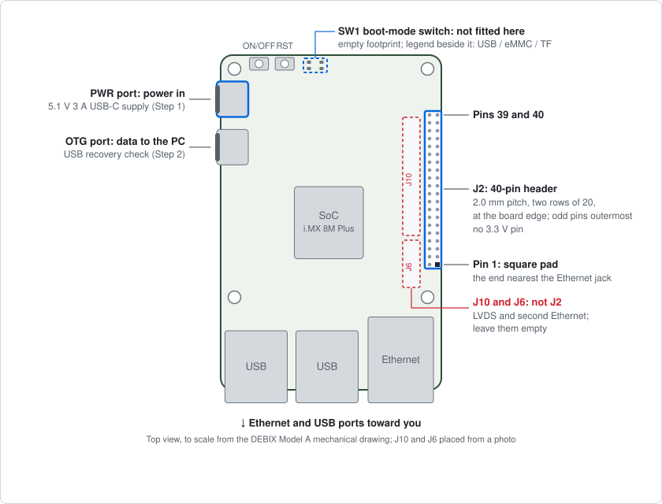
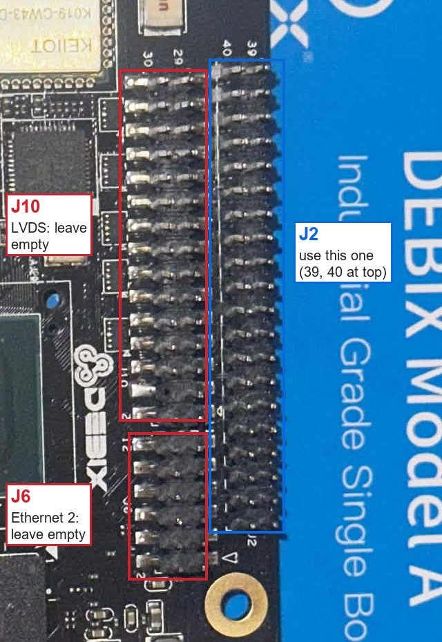
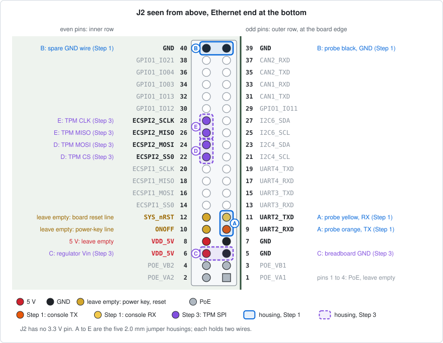
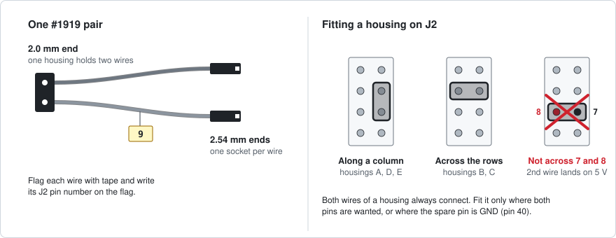
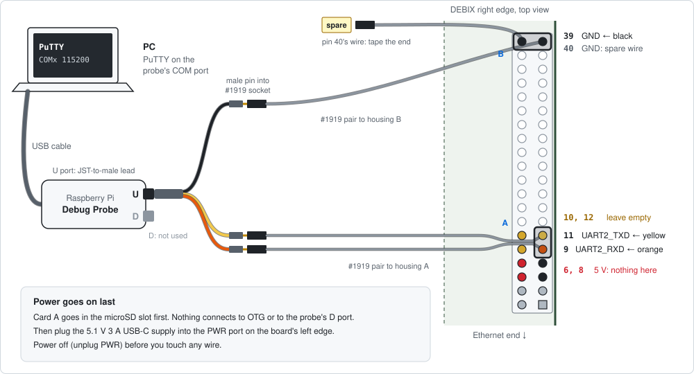

# Bench manual: DEBIX Model A and TPM

This manual walks through P2's hardware work on the companion computer, a DEBIX Model A with an SPI TPM 2.0, one step at a time. Each step is written before it is run and corrected afterwards, so it matches what actually worked on the bench. The [bench log](log.md) records when each step ran and what went wrong.

Nothing in Steps 1 to 4 changes the board permanently. The fuse steps that do (docs/02 §2.7, OI2-02) are not in this manual.

| Step | What it does | Needs | Status |
|---|---|---|---|
| [1](#step-1-first-boot-with-the-serial-console) | First boot of the vendor image, with the serial console on the PC | Board, Debug Probe, card A | Started 2026-10-24; wiring and boot (1.4 to 1.6) not yet recorded |
| 2 | USB recovery check and a read-only fuse read | Step 1, USB-A to USB-C cable, NXP `uuu` | Not written yet |
| 3 | 3.3 V supply for the TPM, measured before the TPM goes on | Step 2, breadboard, regulator, meter | Not written yet |
| 4 | Check that the TPM answers on ECSPI2 | Step 3, the TPM (due about 2026-11-13) | Waiting for the TPM |
| 5 | Pixhawk 6X console and read-only SWD | The Pixhawk (not bought) | Not started |

## Rules for every step

1. **Never write a fuse.** Read them only. `fuse prog` burns a fuse for good, and `fuse override` has no place here either. Burning the SRK hash and closing the chip each need the owner's go-ahead at that moment.
2. **Unplug the power before you connect, move or remove any wire.**
3. **J2 pins 6 and 8 carry 5 V.** Nothing touches them except the regulator input on pin 6 in Step 3.
4. **Leave J2 pins 10 and 12 empty.** They are the power-key and board-reset lines.
5. **Card A keeps the vendor image and is never changed.** P2's own work goes on card B.
6. **Touch grounded metal before you handle the board**, the TPM or the Pixhawk.
7. **Take the photos each step asks for.** They go into the session folder with the PuTTY log, and the bench log is written from them.

## What you need

| Part | Used in | Notes |
|---|---|---|
| DEBIX Model A, 2 GB (OKdo EMB-iMX8MP-02) | All | |
| Raspberry Pi Debug Probe (Adafruit #5699) | 1, 5 | Use its USB cable and its JST-to-male lead (the one with male pins) |
| 2.54 to 2.0 mm F/F jumpers (Adafruit #1919) | 1, 3 | Read [the jumper section](#the-254-to-20-mm-jumpers) first |
| Raspberry Pi 5.1 V 3 A USB-C supply (Adafruit #4298) | All | Powers the DEBIX |
| 2 × 32 GB microSD, marked A and B | 1 (A), later (B) | Write on the card with a fine marker; tape can jam the slot |
| USB-A to USB-C cable (Adafruit #4474) | 2 | PC to the DEBIX OTG port |
| Breadboard (#3314), M/M jumpers (#1957), LD1117-3.3 (#2165), 2 × 10 µF electrolytic capacitors | 3 | |
| Multimeter | 3 | |
| ANAVI TPM 2.0 (Infineon SLB9672) | 4 | |
| Masking tape and a pen | 1, 3 | To flag each wire with its J2 pin number |
| Phone camera | All | |

PC software: [PuTTY](https://www.chiark.greenend.org.uk/~sgtatham/putty/) and [balenaEtcher](https://etcher.balena.io/) for Step 1. NXP `uuu` 1.5.243 comes in Step 2.

## Know your board



Lay the board flat with the Ethernet and USB ports toward you. Every diagram here uses that view.
- **Left edge:** two USB-C ports. The upper one is **PWR** (power in) and the lower one is **OTG** (data to the PC).
- **Top edge:** the ON/OFF and RST buttons, and the place for the **SW1** boot-mode switch. SW1 is not fitted on this board. The silk marks the buttons `ONOFF` and `RST`; the buttons themselves sit on the underside and are pressed from the edge.
- **Right edge:** the 40-pin header **J2**, the two columns of pins nearest the board edge. Pin 1 is at the end nearest the Ethernet jack, and the odd pins run along the board edge. On the underside, pin 1 has a square pad.
- **Beside J2, toward the SoC:** two more columns of pins at the same pitch. **They are not J2.** They are two surface-mount headers end to end: **J10** (LVDS display output, 30 pins) and **J6** (second Ethernet, 12 pins). Nothing in this manual connects to them.



To tell them apart on the board: the silk prints `40` and `39` at the far end of J2, and `30` and `29` at the far end of J10. From the underside only J2 shows, because its pins are soldered through the board and J10 and J6 are not.

The positions are drawn from the DEBIX Model A mechanical drawing. They were checked against photos of this board on 2026-11-09 ([bench log](log.md)).

## The J2 header



J2 is two rows of 20 pins at **2.0 mm pitch**, smaller than a Raspberry Pi header. Count pins on J2 only, never on J10 or J6 beside it ([Know your board](#know-your-board)). It has **no 3.3 V pin**, so Step 3 adds a regulator. The signals come from the DEBIX Model A schematic V05, and the ECSPI2 pins agree with the [DEBIX GPIO manual](https://debix.io/Software/blog_info/id/60.html). The SPI and UART pins run at 3.3 V, so no level shifter is needed.

The pins this manual uses:

| Pin | Signal | Step | Connects to | Housing |
|---|---|---|---|---|
| 9 | UART2_RXD | 1 | Debug Probe orange wire (probe TX) | A |
| 11 | UART2_TXD | 1 | Debug Probe yellow wire (probe RX) | A |
| 39 | GND | 1 | Debug Probe black wire | B |
| 40 | GND | 1 | Nothing: the housing's spare wire, end taped | B |
| 5 | GND | 3 | Breadboard ground rail | C |
| 6 | VDD_5V | 3 | Regulator input | C |
| 22 | ECSPI2_SS0 | 3 | TPM CS | D |
| 24 | ECSPI2_MOSI | 3 | TPM MOSI | D |
| 26 | ECSPI2_MISO | 3 | TPM MISO | E |
| 28 | ECSPI2_SCLK | 3 | TPM CLK | E |

## The 2.54 to 2.0 mm jumpers



At its 2.0 mm end, each #1919 pair has **one housing holding two wires**. Adafruit's page calls it "a single 2x2.00mm socket", and single-wire 2.0 mm housings aren't sold. So every housing connects two J2 pins at once, and both wires are live.

This manual uses five housings, A to E. Each sits where both of its pins are wanted, or where the spare pin is GND:
- **Along a column:** A on 9 and 11, D on 22 and 24, E on 26 and 28.
- **Across the rows:** B on 39 and 40, C on 5 and 6.

Never fit a housing across 7 and 8 (5 V), 9 and 10, or 11 and 12 (the power-key and reset lines). An earlier plan did exactly that, assuming one wire per housing; the [bench log](log.md) records the correction.

Working with them:
1. Peel one pair off the ribbon for each housing.
2. Push the housing straight down until it seats fully. Pull it off by the housing, never by the wires.
3. Flag both wires near their 2.54 mm ends with masking tape, and write each wire's J2 pin number on its flag.

## Step 1: First boot with the serial console

**Goal:** the vendor Ubuntu boots from card A, and the messages from U-Boot (the boot loader) and Linux appear in PuTTY on the PC. Nothing on the board changes.

**Time:** about 45 minutes. Most of it is writing the card.

**You need:** the board, card A, the Debug Probe with its USB cable and JST-to-male lead, two #1919 pairs, the 5.1 V 3 A supply, masking tape, a pen and a phone.

### 1.1 Make card A (on the PC)

1. From the [DEBIX OS images page](https://debix.io/Software/downloadn.html), download the **Ubuntu 22.04** SD-card image. On 2026-10-24 that was `DEBIX-Model-A-B-Infinity_Ubuntu22.04_L6.1.22_V3.14_20260325.img`: V3.14, 4 GiB, listed MD5 `16C56AA936BC02503C8AB4CC4DF4B048`.
2. Check the download in PowerShell. The hash must equal the one on the page. Record it.
   ```powershell
   Get-FileHash -Algorithm MD5 .\DEBIX-Model-A-B-Infinity_Ubuntu22.04_L6.1.22_V3.14_20260325.img
   ```
3. Insert card A in the PC. In balenaEtcher, choose **Flash from file**, then the image, then **Select target**. Pick the microSD card, and check its size so you don't pick another drive. Then click **Flash**. Etcher checks the card after writing.
4. If Windows offers to format a drive afterwards, click **Cancel**. This is normal: Windows can't read the card's Linux partitions.

### 1.2 Set up PuTTY (on the PC)

1. Plug the Debug Probe into the PC with its USB cable. In Device Manager, under **Ports (COM & LPT)**, a new **USB Serial Device (COM*n*)** appears. Note *n*. If several ports are listed, unplug the probe and plug it back in to see which one it is.
2. In PuTTY, open the **Session** page. Set Connection type to **Serial**, Serial line to **COM*n***, and Speed to **115200**.
3. On **Connection → Serial**, set Data bits **8**, Stop bits **1**, Parity **None** and Flow control **None**.
4. On **Session → Logging**, choose **All session output**. Set the log file to the session folder followed by `putty-&Y&M&D-&T.log`, for example `C:\Users\<you>\p2-bench\2026-10-24\putty-&Y&M&D-&T.log`. PuTTY replaces `&Y&M&D-&T` with the date and time, but it won't create the folder, so make the folder first.
5. Back on **Session**, type `debix-console` under Saved Sessions and click **Save**.

### 1.3 Look at the board and set SW1 (unpowered)

1. **Photo:** the whole board, top side, then underside, in good light.
2. Find J2 from the top: the two columns of pins at the board edge, with `40` and `39` printed at the far end. The columns beside them, with `30` and `29`, are J10. Then find J2's pin 1: the square pad on the underside at the Ethernet end of J2, in the column at the board edge. **Photo:** a close-up.
3. Find SW1's place on the top edge, right of the RST button. **On this board SW1 is not fitted.** Only its footprint is there, with the legend that gives a two-digit code for each boot source: USB, eMMC and TF (microSD). There is nothing to set: with a card in, the board should boot from it, and this step confirms that. **Photo:** a close-up of the empty footprint, with the legend readable.
4. If your board has SW1 fitted, set it to the code the legend gives for **TF**. DEBIX's manual gives it as `11`. On a DIP switch a 1 usually means ON; check the ON marking on the switch body. **Photo:** SW1 before and after.

### 1.4 Wire the console (unpowered)



1. Peel two pairs off the #1919 ribbon.
2. **Housing A:** push the first housing onto **pins 9 and 11**. They sit in J2's outer row at the board edge, the 5th and 6th pins from the Ethernet end. Pins 10 and 12 beside them, in J2's inner row, stay bare.
3. Follow the two wires to their 2.54 mm ends. Flag the one from pin 9 with **9** and the one from pin 11 with **11**.
4. **Housing B:** push the second housing across **pins 39 and 40**, the last pair at the far end from the Ethernet jack. Flag its wires **39** and **40**.
5. Plug the JST-to-male lead into the probe's **U** port. Nothing goes in the D port.
6. Plug the lead's male pins into the #1919 sockets:
   - **orange** (probe TX) into socket **9**;
   - **yellow** (probe RX) into socket **11**;
   - **black** (GND) into socket **39**.
7. Wrap tape over the end of socket **40**. It is the spare wire, on GND.

Check before any power goes on:
- [ ] Pins 6, 8, 10 and 12 are bare.
- [ ] Nothing is on J10 or J6, the pin columns beside J2.
- [ ] Housing A is fully seated on 9 and 11; housing B on 39 and 40.
- [ ] Orange goes to 9, yellow to 11 and black to 39.
- [ ] **Photo:** a close-up of the wiring where the pins can be counted.

### 1.5 Boot and log in

1. Insert card A in the DEBIX's microSD slot.
2. In PuTTY, select `debix-console`, then click **Load** and **Open**. The window stays blank for now.
3. Plug the 5.1 V 3 A supply into the **PWR** port.
4. Within a few seconds, U-Boot's messages should scroll, then the Linux boot log, then a `login:` prompt. If the screen goes quiet, press Enter.
5. Log in as `debix` with password `debix`, the default listed on DEBIX's images page.
6. Change the password straight away with `passwd`. Keep the new one somewhere safe, not in the repo.
7. Run these three commands. The `echo` adds the newline the model string lacks.
   ```sh
   uname -a
   cat /proc/device-tree/model; echo
   ls -l /sys/class/spidev/
   ```
8. In the `spidev` listing, find the entry whose link contains `30830000.spi`. That is ECSPI2. Note its name, for example `spidev1.0`; Step 4 uses it.

### 1.6 Shut down

1. Run `sudo poweroff`. Wait for `reboot: Power down`, or for 10 seconds of silence.
2. Unplug the supply from PWR, then close PuTTY. The log is already saved.
3. Leave the console wiring in place for Step 2.

### What to record

| Record | From | Bears on |
|---|---|---|
| Image file name and the MD5 you computed | 1.1 | Recreating card A |
| Photos: top, underside, pin 1, SW1's footprint and legend | 1.3 | Board facts the diagrams assume |
| That SW1 is not fitted, and the legend's codes | 1.3 | OI2-07 (recovery), in Step 2 |
| Wiring close-up | 1.4 | This manual |
| PuTTY log: U-Boot banner, kernel log, the three commands | 1.5, saved automatically | Baseline |
| The `spidev` name for `30830000.spi` | 1.5 | Step 4 |

### If it goes wrong

| What you see | Likely cause | What to do (power off first) |
|---|---|---|
| PuTTY stays blank after power-on | Orange and yellow swapped | Swap the orange and yellow pins between sockets 9 and 11 |
| Still blank | Wrong COM port, black wire loose, or speed not 115200 | Check each in turn |
| Garbled characters | Wrong speed | Set 115200, 8N1, no flow control |
| Messages appear but typing does nothing | Orange not reaching pin 9 | Reseat housing A and the orange pin |
| No U-Boot messages at all | Card not seated or not written | Reseat the card; if that fails, write it again |
| No `30830000.spi` in the listing | The image's devicetree differs from the one P2 checked | Record it. Don't change the devicetree; ask first |

## Steps 2 to 5

Each step will be written in this format before it is run: recovery check and fuse read (2), the TPM's power supply (3), the TPM on SPI (4), and the Pixhawk bench check (5).

## Sources

- DEBIX Model A schematic V05 and mechanical drawing, from Polyhex. The schematic names J10 (dual LVDS output, `SMT_2x15_2P0`) and J6 (second Ethernet, `SMT_2x6_2P0`), and gives SW1's boot-mode table. They are kept outside the repo with SHA-256 `d8e6a773…b062b506` (schematic) and `2777cd11…08349358` (drawing).
- [DEBIX GPIO manual](https://debix.io/Software/blog_info/id/60.html), for J2 functions.
- [DEBIX OS images](https://debix.io/Software/downloadn.html), read on 2026-10-24: image name, MD5 and default login.
- [Adafruit #1919](https://www.adafruit.com/product/1919): each 2.0 mm housing holds two wires.
- [Raspberry Pi Debug Probe documentation](https://www.raspberrypi.com/documentation/microcontrollers/debug-probe.html): U and D ports; orange = TX/SC (output from the probe), black = GND, yellow = RX/SD.
