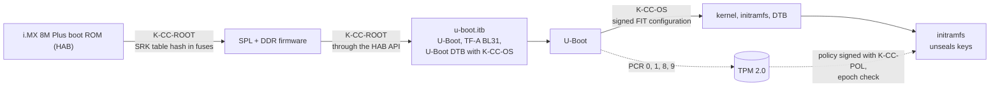

# 2. CC boot chain

The CC verifies its boot chain in two stages. First, the SoC's boot ROM verifies the boot loader against a table of public keys whose hash is burned into fuses: the hardware root of trust for SR-005. Then U-Boot verifies a signed FIT configuration that covers the kernel, initramfs and devicetree. U-Boot takes no configuration from storage or the console (SR-005.1). U-Boot also measures what it boots into the TPM (§3).

Status: the boot-loader configuration (§2.3) passes in emulation (TC-01, TC-03, TC-04). The hardware stages and the measurements are design. The CC board is on order and no hardware run has happened. Nothing is shown working until its test case passes ([§6](06-verification.md)).

## 2.1 Hardware target

| | DEBIX Model A (NXP i.MX 8M Plus) + SPI TPM | Raspberry Pi 4 + SPI TPM | Raspberry Pi 5 + SPI TPM | ST STM32MP135F-DK + SPI TPM |
|---|---|---|---|---|
| Root of trust | Boot ROM (HABv4) verifies SPL against a table of up to four keys (SRKs) whose hash is fused; SPL has HAB verify `u-boot.itb` against the same table [UBOOT-HAB], [UBOOT]. No vendor-signed stage runs before the project's key | ROM checks Raspberry Pi's signature on `bootsys`; `bootsys` checks the customer key against an OTP hash; `boot.img` is verified with RSA-2048 [RPI-SB] | As Pi 4, and the ROM also requires a customer counter-signature on `bootsys` [RPI-SB] | ROM verifies TF-A BL2 against ECDSA key hashes in OTP [UBOOT] |
| Root key | RSA-4096, 128-bit; up to four, each revocable by fuse [NXP-CST] | RSA-2048, 112-bit [RPI-SB] | RSA-2048, 112-bit [RPI-SB] | ECDSA P-256, 128-bit [UBOOT] |
| U-Boot reaches the TPM | Native ECSPI driver (`MXC_SPI`). A mainline board on the same SoC has an SPI TPM on `ecspi2` (Gateworks Venice GW71xx). The DEBIX devicetree enables no ECSPI node, so P2 adds one [UBOOT]. Not yet shown (OI2-01) | Only through GPIO soft SPI (`spi-gpio`). No BCM2711 SPI driver in U-Boot `v2026.07` [UBOOT] | No. The header pins are behind RP1, and U-Boot has no RP1 driver [UBOOT] | Driver exists (`STM32_SPI`), but the board's `spi5` is disabled in its devicetree and defconfig [UBOOT]. Header pins not confirmed |
| Irreversible steps | Two: burning the SRK hash (the chip still boots unsigned images), then burning SEC_CONFIG to close the chip (only signed images boot) [UBOOT-HAB], [NXP-FUSE] | Programming the OTP key hash | Programming the OTP key hash | Programming the OTP key hashes |

**Choice (DD2-01): Polyhex DEBIX Model A (NXP i.MX 8M Plus, 2 GB) with an SPI TPM 2.0 module on ECSPI2.** U-Boot reaches the TPM through a native SPI driver, and the ROM takes 128-bit root keys that can be revoked. The board bought is OKdo `EMB-iMX8MP-02`, 2 GB; mainline U-Boot sets this board up for 2 GB of DRAM (`PHYS_SDRAM_SIZE`) [UBOOT].

The Raspberry Pi 4 was the first choice and is the documented alternative. It was replaced on 2026-10-12, before any hardware was bought, for two reasons. Its U-Boot reaches a TPM only through GPIO soft SPI, which public reports show working only on 2020–2024 U-Boot. And it fixes the root key at RSA-2048, which NIST SP 800-57 disallows for new signatures from 2031 [SP800-57]. The Pi 5 cannot measure the boot before Linux runs, which undercuts SR-010. The STM32MP135F-DK has a 128-bit ROM key, but its header SPI is unproven, and its single Cortex-A7 is a poor stand-in for a companion computer.

**Why the TPM, not the fuses, holds the keys.** HAB fuses hold only the hash of the public key table; no secret is stored in them. The CC's secrets are in the TPM, which releases them only to the measured state.

## 2.2 Stages

| Stage | Verified by | Key | Measured into |
|---|---|---|---|
| SPL and DDR training firmware | Boot ROM (HAB) | K-CC-ROOT, RSA-4096; SRK table hash in fuses | — |
| `u-boot.itb`: U-Boot, TF-A BL31, U-Boot control devicetree | SPL, through the ROM's HAB API | K-CC-ROOT | — |
| Signed FIT: kernel, initramfs, devicetree | U-Boot | K-CC-OS, RSA-3072 with SHA-256, required for every configuration | PCR 0 (U-Boot version), PCR 1 (devicetree, kernel command line), PCR 8 (kernel), PCR 9 (initramfs) |
| Root filesystem | Kernel (dm-verity) | P4 (SR-006) | — |

With `IMX_HAB` set, U-Boot's build signs SPL and `u-boot.itb` with NXP's Code-Signing Tool while it assembles `flash.bin` [UBOOT].

**HAB enforces only on a closed chip.** Until SEC_CONFIG is burned, a failed check is logged as a HAB event and the boot continues: U-Boot's HAB call reports success on an open chip [UBOOT]. So the hardware root of trust refuses anything only after the second fuse step (OI2-02, TC-02).

**One signature over everything.** U-Boot verifies the signed *configuration*, which lists every image it uses (`sign-images = "kernel", "fdt", "ramdisk"`). Signing images one by one would let an attacker pair signed images that were never released together [UBOOT-SIG] (DD2-04).

## 2.3 Boot-loader configuration (SR-005.1)

"Boot configuration" in VE-07 means everything that decides what U-Boot boots: its environment, its console and the FIT configuration it picks. All of it either lives inside the verified boot-loader image or is covered by the FIT signature.

| U-Boot setting | Value | Why |
|---|---|---|
| `FIT_SIGNATURE` | on; key marked *required* in the control devicetree | Unsigned or wrongly signed configurations are refused |
| `LEGACY_IMAGE_FORMAT` | **off** | Legacy uImages carry no signature. `qemu_arm64_defconfig` turns them on, so the fragment must turn them off [UBOOT] |
| `ENV_IS_NOWHERE` | on | The environment is compiled into the verified image; nothing is read from flash or disk |
| `BOOTDELAY` | `-2` | Autoboot with no check for a keypress [UBOOT] |
| `BOOTSTD_BOOTCOMMAND` | off | Standard boot would scan disks for scripts and `extlinux.conf`, which are not signed |
| `BOOTCOMMAND` | Read a fixed-size raw FIT slot, `bootm` it, then `reset` | Nothing reaches a prompt: any failure resets. No filesystem is parsed before the signature check (DD2-05) |
| `MEASURED_BOOT` | on | §3 |

The settings live in [`cc/uboot/p2.config`](../cc/uboot/p2.config), with the board-specific boot command in [`cc/uboot/qemu.config`](../cc/uboot/qemu.config). [`cc/build.sh`](../cc/build.sh) fails if any line is missing from the built `.config`, and TC-04 checks it again. The FIT source is [`cc/fit/cc.its`](../cc/fit/cc.its).

## 2.4 Emulated chain

CI runs the same U-Boot configuration on QEMU's `virt` machine with swtpm. The differences are deliberate and are listed so that evidence is read correctly.

| | Hardware (DEBIX Model A) | Emulated (QEMU `virt`) |
|---|---|---|
| Root of trust | Boot ROM (HAB) and the fused SRK hash verify SPL and `u-boot.itb`; enforced only on a closed chip (§2.2) | None. QEMU loads `u-boot.bin`, trusted by assumption (A2-03) |
| Where K-CC-OS lives | U-Boot control devicetree inside the HAB-signed `u-boot.itb` | U-Boot control devicetree passed by QEMU with `-dtb`. U-Boot on QEMU takes its devicetree from the prior stage and refuses `OF_SEPARATE` [UBOOT], [UBOOT-QEMU] |
| Boot-loader configuration | `imx8mp_debix_model_a_defconfig`, `p2.config` and a DEBIX fragment. The defconfig keeps the environment in MMC (`ENV_IS_IN_MMC`) [UBOOT], so the DEBIX fragment must turn it off, and the `.config` check must cover it | `qemu_arm64_defconfig`, `p2.config` and `qemu.config` |
| TPM | SPI TPM on ECSPI2 through `MXC_SPI` | swtpm through `tpm-tis-device` and U-Boot's `TPM2_MMIO` [QEMU] |
| FIT storage | Raw area on the SD card | Raw virtio disk |
| Devicetree | Upstream `imx8mp-debix-model-a` devicetree, plus P2's ECSPI2 and TPM nodes | Dumped from QEMU with the *same* command line used to boot. A dump taken without `-bios` crashed the kernel during AMBA probing in a prototype run |
| Control runs | — | The same U-Boot release built from stock `qemu_arm64_defconfig`, to show that the environment and legacy-image attacks TC-04 tries succeed without the P2 settings. For the console attacks, the P2 build with exactly one setting changed: the autoboot delay restored ([`controls/bootdelay.config`](../cc/uboot/controls/bootdelay.config)) or the final `reset` removed ([`controls/noreset.config`](../cc/uboot/controls/noreset.config)). These builds are never used to boot a CC |

## 2.5 Anti-rollback

Neither stage provides it in P2. U-Boot `v2026.07` has no FIT anti-rollback option [UBOOT], and its HABv4 guides describe no image-version check [UBOOT-HAB].

P2 enforces anti-rollback at **key release**: an older signed chain may boot, but cannot unseal the keys (SR-010.3, §3.4). Without the WireGuard key it cannot reach the GCS. Without the MAVLink signing key the FC rejects everything it sends. So a rolled-back CC cannot join C2, and the vehicle falls back to the data-link-loss failsafe (P1 DD-05).

Refusing to *boot* an older chain would need a U-Boot patch that reads the TPM epoch through `tpm2_nv_read_value` and compares it with a signed FIT property. U-Boot's `tpm2` shell command cannot read NV [UBOOT]. That option (SR-005.2) was considered and not adopted (DD2-07).

## 2.6 Design decisions

| ID | Decision | Rationale | Alternative considered |
|---|---|---|---|
| DD2-01 | CC hardware: Polyhex DEBIX Model A (NXP i.MX 8M Plus, 2 GB) with an SPI TPM 2.0 module on ECSPI2 | §2.1. Native SPI driver for the TPM; 128-bit root keys that can be revoked; within budget. Replaced the Raspberry Pi 4 on 2026-10-12, before any hardware was bought | Raspberry Pi 4 (TPM only through soft SPI; RSA-2048 root key); Pi 5 (U-Boot cannot reach the TPM); STM32MP135F-DK (header SPI unproven, low fidelity); i.MX 8M Plus EVK, NXP NavQPlus, Gateworks Venice (over budget) |
| DD2-02 | Two verification stages: HAB (K-CC-ROOT) then U-Boot FIT (K-CC-OS) | The fused key table can never be extended. Keeping K-CC-ROOT for the rarely changed boot loader lets K-CC-OS rotate with a new `u-boot.itb` | U-Boot checks the kernel with HAB instead of a FIT signature: ties every kernel release to K-CC-ROOT |
| DD2-03 | U-Boot takes no configuration from storage or the console (§2.3) | SR-005.1 | Signed boot scripts: more moving parts |
| DD2-04 | Sign configurations, covering every image | Prevents mixing images from different releases [UBOOT-SIG] | Per-image signatures |
| DD2-05 | FIT read from a fixed-size raw slot | No filesystem parser runs on attacker-controlled storage before the signature check | Load from FAT or ext4 |
| DD2-06 | CI evidence from QEMU `virt` + swtpm; hardware evidence from the DEBIX | §2.4, [§6](06-verification.md) | TF-A trusted board boot under QEMU to emulate a root of trust: possible later, not needed for the hardware claim |
| DD2-07 | Anti-rollback at key release (SR-010.3), not at boot | §2.5 | U-Boot patch (SR-005.2) |
| DD2-16 | K-CC-ROOT is a table of RSA-4096 SRKs | U-Boot's CST signing template defaults to RSA-4096 [UBOOT], which is 128-bit [SP800-57]. Whether ECDSA SRKs need a newer CSF version than U-Boot writes is unconfirmed | ECDSA P-256 or P-384 SRKs, which HAB supports on the i.MX 8M Plus only [NXP-CST] |
| DD2-17 | The TPM's reset pin stays on the module's pull-up: power-on reset only, never wired to a GPIO | A GPIO-driven reset lets root on the CC reset the TPM and replay approved measurements (A2-02). U-Boot's SPI TPM driver warns against GPIO reset on production devices [UBOOT]. With power-on reset only, a warm reboot keeps the old PCRs, so the next boot's measurements do not match and unseal fails closed until a power cycle | Wire it to a board reset output, if the DEBIX header has one (not confirmed); a GPIO, as Raspberry Pi TPM boards do |

## 2.7 Open items

| ID | Item | Closed by |
|---|---|---|
| OI2-01 | U-Boot driving the SPI TPM on ECSPI2 of the DEBIX has not been shown (A2-06). Fallback: measure from the verified initramfs, recorded as a deviation from SR-010.1 | First hardware spike |
| OI2-02 | HAB enforces only on a closed chip (§2.2). Burning the SRK hash and closing the chip are separate permanent steps; a wrong SRK hash on a closed chip leaves a board that does not boot [UBOOT-HAB]. Not yet known whether HAB events mean anything before the SRK hash is burned | TC-02 needs both steps. Each is taken only with the owner's explicit go-ahead at that moment |
| OI2-03 | Closed 2026-10-12 by DD2-01. It asked whether U-Boot could run inside a Raspberry Pi secure-boot `boot.img`; on the i.MX 8M Plus, U-Boot is HAB's native payload | — |
| OI2-07 | How to recover the DEBIX is not confirmed: its boot-mode selection and USB serial download (`uuu`) | Before any fuse is burned |
| OI2-08 | Vendor sources disagree on the ECSPI2 chip-select and clock pins of the DEBIX header J2 [DEBIX-GPIO]. The 3.3 V supply pin is not confirmed | Schematic or a meter, before the TPM is powered |
